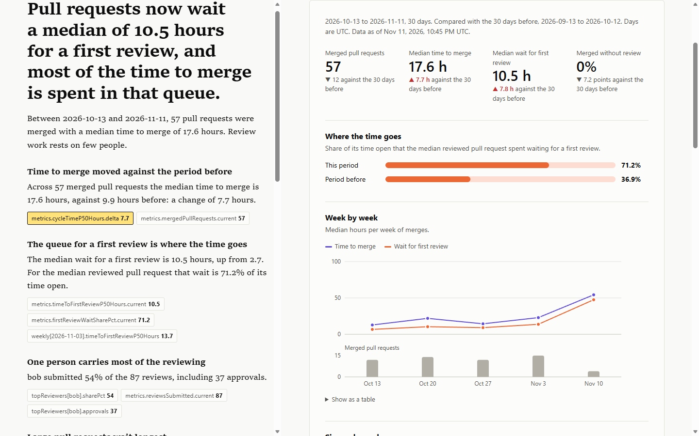

# Review Flow Insights

A service that shows where the time between opening and merging a pull request goes in a
GitHub repository, and how that changed from the previous period.

It syncs merged pull requests and their reviews from GitHub into SQLite, computes the
review-flow insight for any period, and has an LLM write a short narrative over the numbers:
what is unusual, a root-cause hypothesis when the data supports one, a confidence score, and
the figures each claim rests on.



_The UI on synthetic demo data with a scripted narrative. Serif text comes from the model;
everything else is computed. Selecting an evidence chip highlights the figure it cites._

## Quickstart

You need Node.js 22.12 or newer (24 is what `.nvmrc` pins) and a GitHub personal access
token. Public data needs no scopes at all: a classic token with nothing ticked, or a
fine-grained token with read-only access to public repositories.

```bash
npm install
cp .env.example .env        # set GITHUB_TOKEN; add ANTHROPIC_API_KEY for narratives
npm run dev                 # http://127.0.0.1:3000
```

Open <http://127.0.0.1:3000>, type a repository such as `fastify/fastify`, and wait for the
first sync. Or use curl:

```bash
# 1. Track a repository. The first sync runs in the background.
curl -X PUT http://127.0.0.1:3000/v1/repos/fastify/fastify

# 2. Poll until sync.coveredFrom is set.
curl http://127.0.0.1:3000/v1/repos/fastify/fastify

# 3. The insight, for the last 30 days or any period of up to 90 days.
curl "http://127.0.0.1:3000/v1/repos/fastify/fastify/insights/review-flow"
curl "http://127.0.0.1:3000/v1/repos/fastify/fastify/insights/review-flow?from=2026-09-01&to=2026-09-30"

# 4. The narrative over the same numbers (needs ANTHROPIC_API_KEY).
curl "http://127.0.0.1:3000/v1/repos/fastify/fastify/insights/review-flow/narrative"
```

Interactive API documentation is served at `/docs`, the OpenAPI document at `/openapi.json`.

With Docker instead of Node: `cp .env.example .env`, fill it in, then
`docker compose up --build`.

Without `ANTHROPIC_API_KEY` everything works except the narrative endpoint, which answers
`503 narrative_not_configured`.

## The metric

Review flow covers every pull request merged into the default branch during a period. It
splits the time from creation to merge in two: the wait for a first review, and the time
from that review to the merge. It also reports the 90th percentile, pull request size, how
the review load is spread across reviewers, and the same figures for the equally long period
immediately before.

Why this metric:

- Cycle time alone does not say what to change. A long wait for review and a long time
  from review to merge have different causes and different owners.
- The narrative endpoint needs several signals that can agree or disagree: the wait,
  reviewer concentration, size, the weekly trend. A single number gives a model nothing to
  form a hypothesis from.
- It needs only pull request metadata, which a read-only token can fetch for any public
  repository in a few GraphQL requests.

### The metrics

Each metric is reported as `{ current, baseline, delta, changePct }`. Durations are hours.

| Metric                                                   | Meaning                                                                                                                 |
| -------------------------------------------------------- | ----------------------------------------------------------------------------------------------------------------------- |
| `mergedPullRequests`                                     | Pull requests by human authors merged into the default branch during the period.                                        |
| `botPullRequests`                                        | Merged pull requests authored by bots. Counted here and excluded from everything else.                                  |
| `activeAuthors`                                          | Distinct human authors with at least one merged pull request.                                                           |
| `cycleTimeP50Hours`, `cycleTimeP90Hours`                 | Median and 90th-percentile hours from creation to merge.                                                                |
| `timeToFirstReviewP50Hours`, `timeToFirstReviewP90Hours` | Hours a pull request waited for its first review by another human, from the moment it became reviewable.                |
| `firstReviewToMergeP50Hours`                             | Median hours from the first review to merge: iterating and getting approval.                                            |
| `firstReviewWaitSharePct`                                | For the median reviewed pull request, the share of its cycle time spent waiting for the first review.                   |
| `mergedWithoutReviewPct`                                 | Share of merged pull requests that no other human reviewed before the merge.                                            |
| `prSizeP50Lines`                                         | Median size in changed lines (additions plus deletions).                                                                |
| `reviewsSubmitted`, `reviewsPerPullRequest`              | Reviews by humans other than the author, submitted before the merge.                                                    |
| `activeReviewers`                                        | Distinct humans who submitted at least one review.                                                                      |
| `topReviewerSharePct`                                    | Share of all reviews submitted by the single most active reviewer.                                                      |
| `reviewersForHalfOfReviews`                              | Smallest number of reviewers who together submitted half of all reviews. Low means review capacity rests on few people. |

Next to the metrics the insight carries the period in 7-day buckets (`weekly`), pull
requests grouped by size (`sizeBuckets`), the most active reviewers and authors, and the
five slowest pull requests.

The definitions live in [`src/insights/schema.ts`](src/insights/schema.ts). The same text
is used for the OpenAPI schema and for the glossary given to the model.

### How the numbers are computed

- Medians and 90th percentiles, not means. Pull request durations are heavy-tailed, and one
  pull request left open over a holiday would dominate an average.
- Every metric is compared with the equally long period before. If synced history does not
  reach that far, `baselinePeriod` and every `baseline`, `delta` and `changePct` are `null`.
- The wait for a first review starts when the pull request left draft, unless it was
  reviewed while still a draft.
- A review counts only if it came from a human other than the author and was submitted
  before the merge. GitHub records an author's replies as reviews; those are excluded.
- Pull requests authored by bots are counted in `botPullRequests` and left out of every
  other metric. Dependency updaters merge in minutes and would pull every median down.
- Values are rounded to one decimal and deltas are computed from the rounded values, so
  `current - baseline` equals `delta`.
- Days are UTC, `from` and `to` are inclusive, and a period is at most 90 days.

The limits of the metric are listed in [NOTES.md](NOTES.md#known-limits).

## The narrative

`GET /v1/repos/{owner}/{name}/insights/review-flow/narrative` returns the model's reading of
the same insight. How it is produced:

1. The insight is flattened into a fact sheet, one `id = value` line per figure, for
   example `metrics.cycleTimeP50Hours.delta = 18.5` or `topReviewers[bob].sharePct = 83.9`.
2. The model returns structured output in which every finding and the hypothesis list the
   fact ids they rest on. The server looks up the values for those ids; the model does not
   supply them.
3. The server verifies the draft. Every cited id must exist. Every number in a finding must
   be the value of a fact that finding cites, or of its sibling (citing a `delta` also
   covers its `current` and `baseline`). Every date and pull request number must appear in
   the fact sheet. A draft that fails is sent back to the model once, with the list of
   problems.
4. If the second draft also fails, the narrative is returned with
   `verification.status: "flagged"` and the issues listed, and it is not cached.
5. The model reports a confidence score and the server caps it by sample size: 0.3 below 5
   pull requests, 0.6 below 20, 0.7 without a baseline, 0.9 otherwise. The response has
   both scores and the reason for the cap.
6. The prompt asks for a hypothesis only when at least two independent signals agree, with
   alternatives and a next check. Otherwise `hypothesis` is `null`.

An abbreviated response:

```jsonc
{
  "repository": "acme/widgets",
  "period": { "from": "2026-10-15", "to": "2026-11-04", "days": 21 },
  "headline": "Median cycle time rose to 30.5 hours, almost all of it spent waiting for review.",
  "findings": [
    {
      "title": "Cycle time more than doubled",
      "detail": "The median went from 12 hours to 30.5 hours, an increase of 18.5 hours.",
      "evidence": [{ "fact": "metrics.cycleTimeP50Hours.delta", "value": 18.5 }]
    }
    // ...
  ],
  "hypothesis": {
    "statement": "Review capacity is a bottleneck.",
    "reasoning": "The wait for review grew by 22.5 hours while a single reviewer handled every review.",
    "evidence": [
      { "fact": "metrics.timeToFirstReviewP50Hours.delta", "value": 22.5 },
      { "fact": "metrics.reviewersForHalfOfReviews.current", "value": 1 }
    ],
    "alternatives": ["The pull requests may have been harder to review."],
    "nextCheck": "Check whether other reviewers were away during the period."
  },
  "confidence": {
    "score": 0.8,
    "modelScore": 0.8,
    "ceiling": 0.9,
    "ceilingReason": "Pull request metadata shows where time goes, but cannot prove why.",
    "rationale": "Two signals agree across 21 pull requests."
  },
  "caveats": [],
  "verification": { "status": "verified", "issues": [], "attempts": 1 },
  "model": "claude-opus-5-5",
  "cached": false
}
```

The structure, evidence values, confidence block and verification result above are real
output of the service for a test fixture; the prose is that fixture's hand-written draft,
standing in for the model.

### Cost

A narrative is generated once per set of numbers. The cache key is a hash of the prompt
version, the model configuration, the repository and the fact sheet, so a re-sync that
changes nothing does not call the model, and concurrent requests for the same narrative
share one call. The instructions are sent as a cached prompt prefix, the endpoint has its
own rate limit, and an empty period is answered without a model.

### Evals

Verification checks that the numbers are real. It does not check the reasoning.
`npm run eval` runs six synthetic periods through the narrative service and checks the
result: a review bottleneck and a size-driven slowdown (each should get the matching
hypothesis), a steady period (no hypothesis), a sample of three pull requests (low
confidence), a period without a baseline, and a reviewer whose login reads like an
instruction. See [`evals/`](evals/scenarios.ts).

## API

| Method and path                                               | Purpose                                                                            |
| ------------------------------------------------------------- | ---------------------------------------------------------------------------------- |
| `PUT /v1/repos/{owner}/{name}`                                | Track a repository and sync it now. Idempotent: `201` the first time, `200` after. |
| `GET /v1/repos`                                               | List tracked repositories with their sync status.                                  |
| `GET /v1/repos/{owner}/{name}`                                | One repository: sync state, `coveredFrom`, stored pull requests.                   |
| `DELETE /v1/repos/{owner}/{name}`                             | Stop tracking and delete its data.                                                 |
| `GET /v1/repos/{owner}/{name}/insights/review-flow`           | The insight. Query: `from`, `to` (UTC, `YYYY-MM-DD`, inclusive).                   |
| `GET /v1/repos/{owner}/{name}/insights/review-flow/narrative` | The narrative over the same insight. Same query.                                   |
| `GET /healthz`, `GET /readyz`                                 | Liveness, and readiness (the database answers).                                    |
| `GET /docs`, `GET /openapi.json`                              | Swagger UI and the OpenAPI 3.1 document.                                           |

`to` defaults to today and `from` to 30 days ending at `to`. Unknown query parameters are
rejected, so a misspelt `form=` is an error.

Responses carry an `ETag` and `Cache-Control: no-cache`, so a client that revalidates gets
an empty `304` when nothing has changed. Every response has an `x-request-id` that also
appears in the logs.

### Errors

Errors are [RFC 9457](https://www.rfc-editor.org/rfc/rfc9457) problem details
(`application/problem+json`). Branch on `code`, show `detail`, quote `requestId`:

```json
{
  "type": "about:blank",
  "title": "Period not covered",
  "status": 422,
  "detail": "Synced history of fastify/fastify starts on 2026-05-15. Choose a period that starts on or after that day.",
  "code": "period_not_covered",
  "requestId": "0b9c1f0e-4c1c-4d5e-9a57-0f0f4f3b9a55"
}
```

| Status | `code`                                                                                  | When                                                                                                 |
| ------ | --------------------------------------------------------------------------------------- | ---------------------------------------------------------------------------------------------------- |
| 400    | `invalid_request`, `invalid_period`                                                     | A malformed name, an unknown parameter, an impossible or too long period. `errors` lists each field. |
| 403    | `private_repository`                                                                    | Private repositories are refused unless `ALLOW_PRIVATE_REPOS=true`.                                  |
| 404    | `repository_not_found`, `repository_not_tracked`, `not_found`                           | GitHub has no such repository; it has not been tracked with `PUT`; no such route.                    |
| 409    | `sync_in_progress`, `sync_failed`, `repository_limit_reached`                           | The first sync has not finished (`Retry-After`), or failed; `MAX_TRACKED_REPOS` reached.             |
| 422    | `period_not_covered`, `repository_empty`                                                | The period starts before the synced history; the repository has no default branch.                   |
| 429    | `rate_limited`                                                                          | 300 requests a minute per client; 20 for `PUT`; 10 for the narrative.                                |
| 502    | `github_unavailable`, `narrative_failed`                                                | GitHub failed; the model returned nothing usable.                                                    |
| 503    | `github_rate_limited`, `narrative_unavailable`, `narrative_not_configured`, `not_ready` | An upstream limit or outage (`Retry-After` where known); no model key; the database is down.         |
| 500    | `internal_error`                                                                        | A bug. The cause is logged under the request id and never returned.                                  |

## Configuration

Environment variables, read from `.env` when present. If one is missing or invalid, startup
fails and names the variable without printing its value.

| Variable                | Default                 | Purpose                                                                                |
| ----------------------- | ----------------------- | -------------------------------------------------------------------------------------- |
| `GITHUB_TOKEN`          | required                | Token for the GitHub GraphQL API.                                                      |
| `ANTHROPIC_API_KEY`     | unset                   | Enables the narrative endpoint.                                                        |
| `LLM_MODEL`             | `claude-opus-5-5`       | Model that writes narratives.                                                          |
| `LLM_EFFORT`            | `medium`                | `low`, `medium`, `high`, `xhigh` or `max`.                                             |
| `HOST`, `PORT`          | `127.0.0.1`, `3000`     | Listen address. Loopback by default because the API has no authentication.             |
| `DATABASE_PATH`         | `./data/review-flow.db` | SQLite file; created on first start.                                                   |
| `SYNC_LOOKBACK_DAYS`    | `180`                   | History backfilled per repository (14 to 730). Bounds the periods that can be queried. |
| `SYNC_INTERVAL_MINUTES` | `15`                    | Background refresh of tracked repositories; `0` disables it.                           |
| `MAX_TRACKED_REPOS`     | `25`                    | Upper bound on stored repositories.                                                    |
| `ALLOW_PRIVATE_REPOS`   | `false`                 | Whether private repositories the token can see may be tracked.                         |
| `LOG_LEVEL`             | `info`                  | pino level.                                                                            |
| `NODE_ENV`              | `development`           | `production` switches logs from pretty-printed to JSON lines.                          |

## Operations

- A background worker syncs one repository at a time and HTTP handlers only read SQLite.
  An insight request is two indexed range reads, and a GitHub outage leaves the data stale
  instead of making the API unavailable.
- The first sync backfills `SYNC_LOOKBACK_DAYS`. Later syncs list pull requests by most
  recent update and stop at the first one unchanged since the previous sync, so refreshing
  a quiet repository takes one request.
- One GraphQL request fetches 50 pull requests with their reviews. Requests time out and
  retry with jittered backoff, and the page size halves when GitHub fails on a page. When
  the rate limit is nearly used up, the queue pauses until it resets.
- On `SIGTERM` the server stops accepting requests, lets the running sync reach a page
  boundary and closes the database. After ten seconds it exits regardless.
- Logs are structured (pino, JSON lines in production): every request with its request id,
  every sync with its duration, every model call with its duration and token counts.
- Schema changes are forward-only migrations applied at startup.

## Security

- Secrets come from the environment only and are never logged or echoed in configuration
  errors. Error responses carry messages written by this service, never the text GitHub
  or the model provider returned.
- Outbound calls go to two hosts, `api.github.com` and the model provider's API. No
  request input affects the destination, and redirects from GitHub are refused. Repository
  names are validated and sent as GraphQL variables. SQL is parameterised.
- Text from GitHub is untrusted. Logins are the only user-chosen strings that reach the
  model. The prompt marks the fact sheet as data, and one eval checks that an
  instruction-shaped login changes nothing. The UI inserts API data as text nodes only,
  under a Content Security Policy without inline script or style.
- The API has no authentication. It binds to loopback, caps the number of tracked
  repositories, refuses private repositories by default, and rate-limits per client, with
  lower limits on the routes that spend GitHub or model quota.
- Request ids are generated by the server and never taken from the request.

## Development

```bash
npm run dev         # run with reload
npm test            # no network: fake GitHub, scripted model, in-memory SQLite
npm run lint        # Biome: lint and format check
npm run typecheck
npm run build       # compile to dist/
npm start           # run the compiled server
npm run eval        # narrative evals against the configured model (spends tokens)
```

```
src/
  server.ts        process entry: configuration, wiring, shutdown
  app.ts           HTTP application: security headers, rate limits, docs, routes
  config.ts        environment parsing
  github/          GraphQL client (timeouts, retries, rate limits) and the queries
  sync/            background sync worker
  store/           SQLite: migrations, repositories, pull requests, narrative cache
  insights/        the review-flow metric: periods, statistics, schema
  narrative/       fact sheet, prompt, model client, verification, service
  http/            routes and problem-details errors
public/            the UI: plain HTML, CSS and ES modules, no build step
evals/             narrative scenarios, grader and runner
test/              mirrors src/
```

The architecture, the decisions behind it, known limits and what comes next are in
[NOTES.md](NOTES.md).
